# Berry Desk Hub

Berry Desk Hub 是一块基于 **Waveshare ESP32-S3-Touch-AMOLED-2.16** 的 480 × 480 桌面状态屏。左右轻扫查看 Codex 任务、电脑和服务器状态，也可以翻到天气、课表或宠物。下拉状态中心，直接调亮度、切换主题或设置网络。

[下载固件](https://github.com/BerryIcey/berry-desk-hub/releases/download/berry-desk-hub-2026.11.08.1/berry-desk-hub-firmware-2026.11.08.1.zip) · [固件 SHA-256](https://github.com/BerryIcey/berry-desk-hub/releases/download/berry-desk-hub-2026.11.08.1/berry-desk-hub-firmware-2026.11.08.1.sha256) · [源码 ZIP](https://github.com/BerryIcey/berry-desk-hub/releases/download/berry-desk-hub-2026.11.08.1/berry-desk-hub-source.zip) · [源码 SHA-256](https://github.com/BerryIcey/berry-desk-hub/releases/download/berry-desk-hub-2026.11.08.1/berry-desk-hub-source.sha256) · [版本说明](CHANGELOG.md)

当前版本 **2026.11.08.1**。

[逐页图册](#gallery) · [状态中心与提醒](#controls) · [刷写固件](#install) · [源码构建与数据接入](#data)

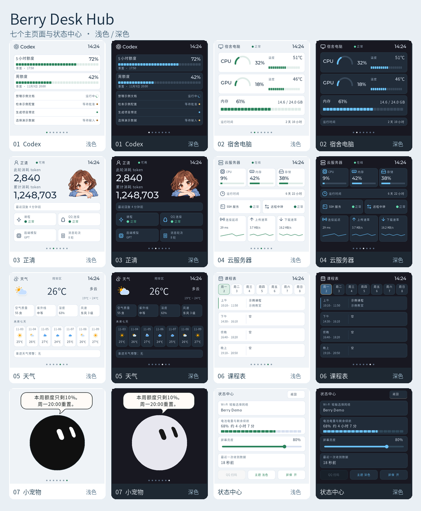

总览和逐页图片均由发布版固件的 LVGL 界面渲染。每张单页保留原始 480 × 480 像素。两种主题使用同一组演示数据，包括任务、监测值、课表、网络名与配对信息。

<a id="gallery"></a>

## 七个主页面

### 01 · Codex

上方两张卡显示当前账号的五小时和周额度，以及各自的重置时间。当前账号仅返回有效周额度时，五小时栏按约定显示 100%，重置时间留空。额度整体不可用时显示 `--`。下方列出最多四条近期任务，用文字、状态点和运行中的转圈提示区分状态。数据来自已登录的 Codex。

| 浅色 | 深色 |
| --- | --- |
| 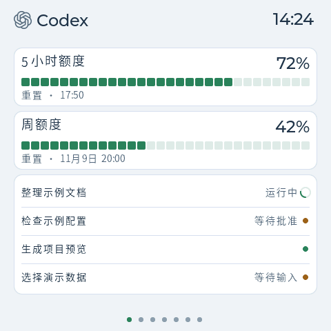 | 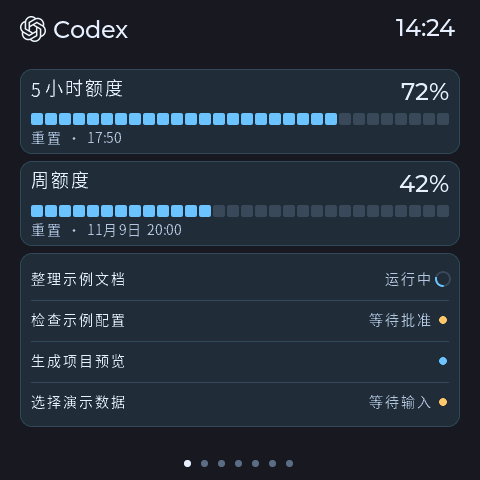 |

### 02 · 宿舍电脑

CPU 和 GPU 各有一张卡，左边的仪表显示占用率，右边显示温度及对应的进度条。下面显示内存占用和容量，再往下是本次运行时间。读数来自 Windows 采集器，缺少 GPU 或温度数据时以占位符显示。

| 浅色 | 深色 |
| --- | --- |
| 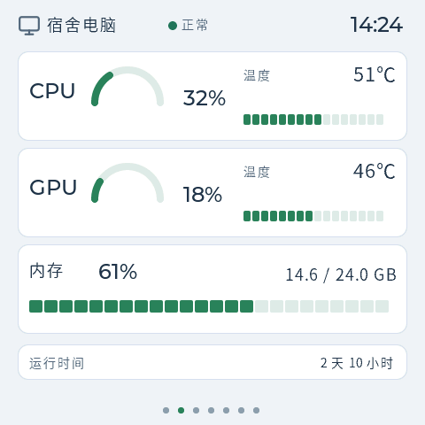 | 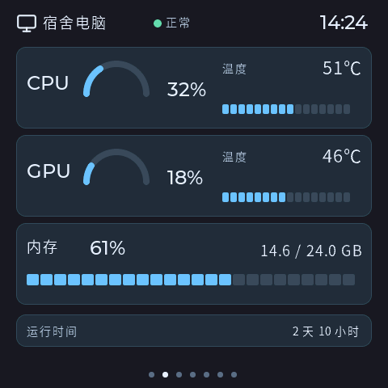 |

### 03 · 芷清

顶部显示服务状态，大数字分别显示此轮和累计记录的 Token。下方可看最近回复时间、进程、QQ 连接、后端模型和今日消息轮次。使用这页需要按实际环境接入芷清采集，缺少数据时显示未知。

| 浅色 | 深色 |
| --- | --- |
| 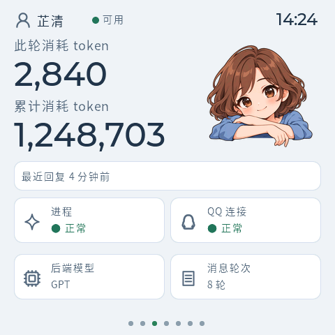 | 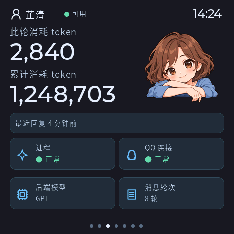 |

### 04 · 云服务器

一屏查看服务器的 CPU、内存、存储和运行时间。中部显示 SSH 与远程中转状态，底部三张卡显示连接延迟、上传和下载速率，并按近期采样画趋势。数据由配置好的服务采集链路提供。

| 浅色 | 深色 |
| --- | --- |
| 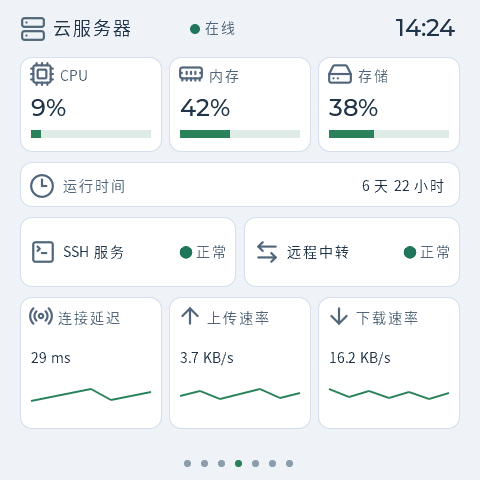 | 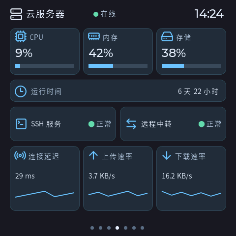 |

### 05 · 天气

当前温度、天气图标和当日高低温放在顶部。中间显示空气质量、紫外线、湿度和风速，下方是未来七天预报和预警摘要。截图所示地区为这版固件的翔安区配置，天气由采集器提供。

| 浅色 | 深色 |
| --- | --- |
| 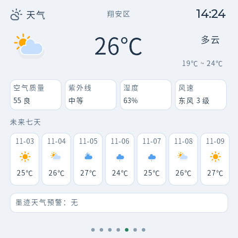 | 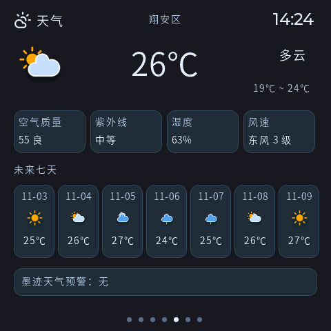 |

### 06 · 课程表

点顶部的周一到周日可切换日期。下方按上午、下午、傍晚和晚上显示课程、时间与教室。课表编进固件，离线也能手选星期。发布版只含一条示例课程，替换后需重新构建。

| 浅色 | 深色 |
| --- | --- |
| 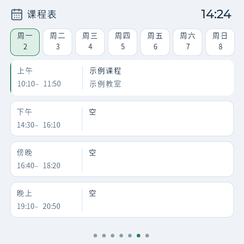 | 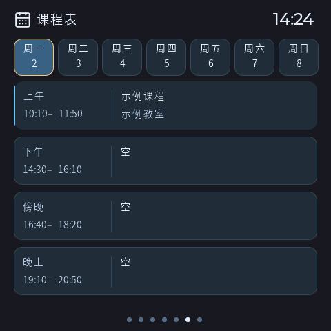 |

### 07 · 小宠物

圆眼宠物会眨眼、转动视线。轻触小圆球，每次都会做动作，约一半的点按还会显示气泡。12 条情境台词只在条件成立时参与抽选，例如真实的课表、天气、硬件读数和周额度。把当前可说的台词随机说完一轮后，再开始下一轮。手头只有一条符合条件时，这条也可以继续出现。

翻到这一页时，可轮播低电量、临近上课、任务待处理、降雨或低额度提示。周额度不超过 10% 且重置时间有效时，会显示剩余额度与北京时间的重置时刻。如果曾收到有效监控采样，之后连续五分钟没有新采样，点按时会把断更提示纳入轮播。新采样到达后，这条自动退出。该功能需要数据服务传递实际采样时间。

高温、持续高负载和明确离线等状态仍会在检测到变化时提示。顶部任务通知按任务状态变化触发。

| 浅色 | 深色 |
| --- | --- |
| 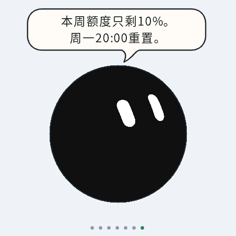 | 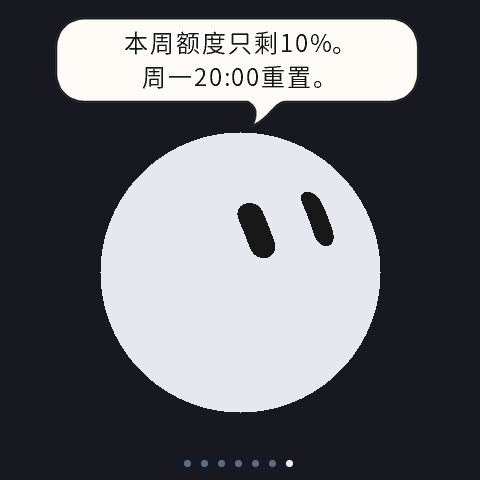 |
|  |  |

<a id="controls"></a>

## 状态中心与提醒

### 状态中心

从主页面向下滑进入。最上面是 Wi-Fi，往下依次是电量与预计续航、亮度滑条、最近收到数据的时间。亮度可调 5% 至 100%，拖动时即时生效，松手保存。底部提供 QQ 扫码、主题和屏保三项操作。

| 浅色 | 深色 |
| --- | --- |
| 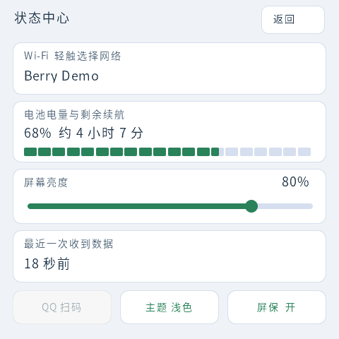 | 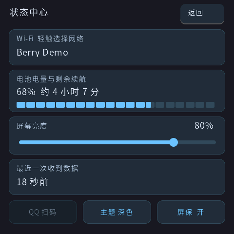 |

### 顶部通知与亮屏

新完成的 Codex 任务、待批准、待输入，以及满足条件的设备异常，会在顶部出现一条带主题色边框的提醒。点任务提醒去 Codex，点硬件异常提醒去对应监控页。熄屏且确认静置时，新任务提醒可以短暂亮屏，约 8 秒无操作后熄屏。短按电源键或屏保熄屏后，放稳再倾斜拿起也可以唤醒。

| 浅色 | 深色 |
| --- | --- |
| 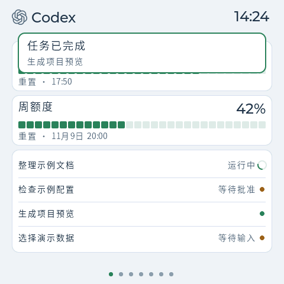 | 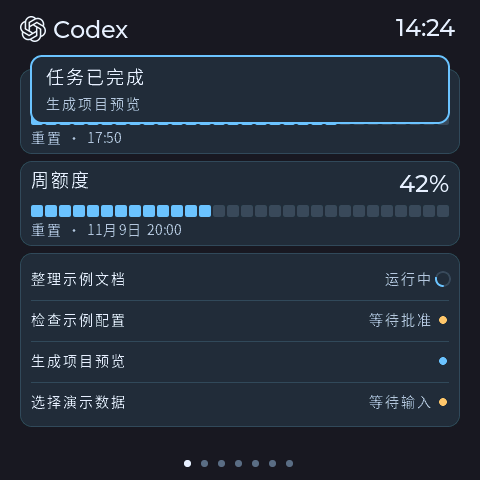 |

<details>
<summary>查看四个网络与登录页面的深浅对照</summary>

### 选择 Wi-Fi

点状态中心的 Wi-Fi 卡扫描附近网络。列表区分已保存、加密和开放网络，点相应行继续连接。

| 浅色 | 深色 |
| --- | --- |
| 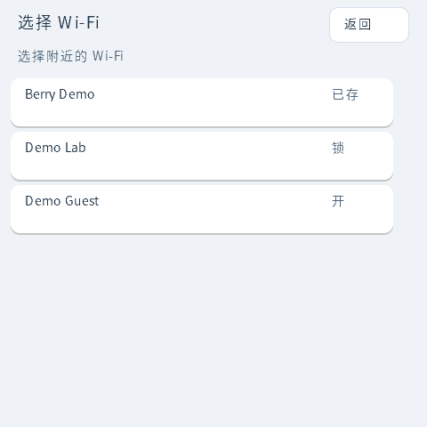 | 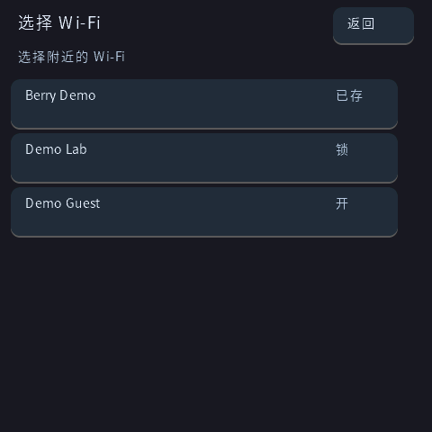 |

### 连接 Wi-Fi

对需要密码的网络，用屏幕键盘输入并确认。开放网络可以直接确认。示例中的网络名是虚构的，输入框保持空白。

| 浅色 | 深色 |
| --- | --- |
| 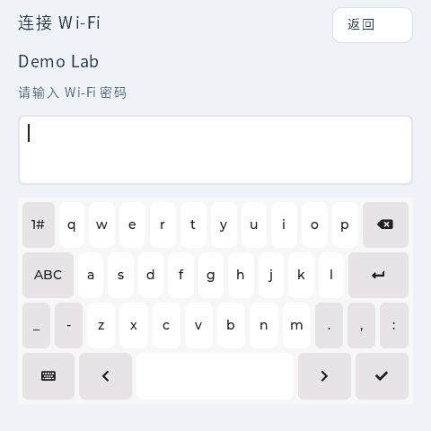 | 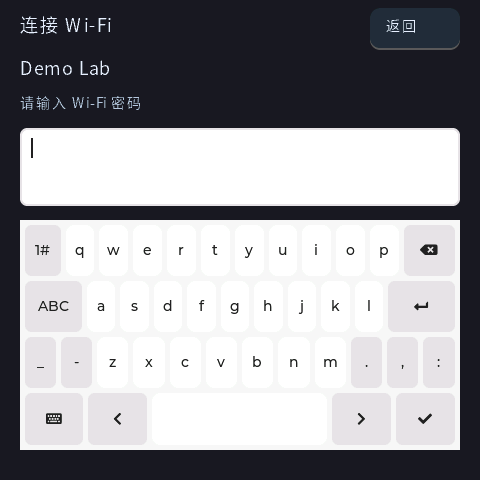 |

### 蓝牙配网

在配网模式下，小屏显示用于 ESP Provisioning 的蓝牙名称和配对码。配网窗口为三分钟，向下滑动可取消。图片中的名称和配对码仅供演示。

| 浅色 | 深色 |
| --- | --- |
| 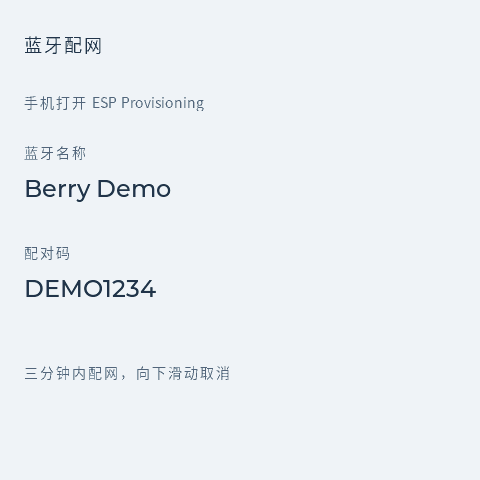 | 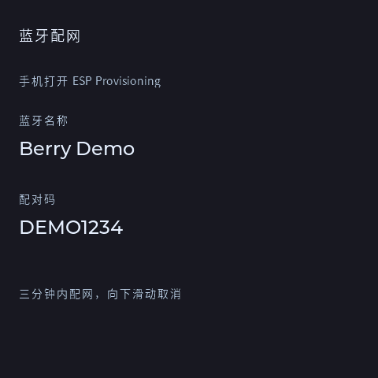 |

### QQ 登录

配置了兼容的登录中转且有有效二维码时，可以从状态中心打开。二维码会更新。下图编码的是演示用的 `example.invalid` 地址。

| 浅色 | 深色 |
| --- | --- |
|  |  |

</details>

<a id="install"></a>

## 刷写固件

固件 ZIP 包内有分离的应用、引导程序、分区表和操作说明，面向 **16 MB 的 Waveshare ESP32-S3-Touch-AMOLED-2.16**。请先核对型号、串口和包的 SHA-256，并备份现有设备。下例以 Windows 的 `COM3` 为例。

```powershell
py -m pip install esptool==4.12.0
Get-FileHash .\berry-desk-hub-firmware-2026.11.08.1.zip -Algorithm SHA256
```

校验 ZIP 后解压，进入含 `.bin` 文件的目录。**同版式设备更新**适用于已经运行 Berry 且应用起始地址为 `0x10000` 的设备，仅写应用分区。

```powershell
py -m esptool --chip esp32s3 --port COM3 --baud 460800 write_flash 0x10000 berry-desk-hub-app.bin
py -m esptool --chip esp32s3 --port COM3 --baud 460800 verify_flash 0x10000 berry-desk-hub-app.bin
```

**首次安装**只在确认可替换现有引导程序与分区布局后使用。备份原有闪存。已有系统的数据布局可能不兼容，刷完后按设备实际状态重新配置 Wi-Fi 和服务端。

```powershell
py -m esptool --chip esp32s3 --port COM3 --baud 460800 write_flash --flash_mode dio --flash_freq 80m --flash_size 16MB 0x0 bootloader.bin 0x8000 partition-table.bin 0x10000 berry-desk-hub-app.bin
```

下载版使用开源思源黑体字形及示例课表。刷写应用会换掉固件内的课表。需要保留自己的课程时，先改源码中的 `firmware/main/berry_schedule.c` 再构建。首次上电后确认屏幕、触摸和按键正常。固件下载版已做构建、镜像结构和原生界面验证，尚未在新板上刷写。

<a id="data"></a>

## 从源码构建与接入数据

1. 解压源码 ZIP，使用 ESP-IDF 5.5 系列工具链。在 `firmware/` 运行 `idf.py -D BERRY_LIGHT_THEME=ON -D METER_INCLUDE_LOCAL_CONFIG=OFF build`，组件版本见 `dependencies.lock`。如果要以深色为首次启动默认值，改用 `-D BERRY_LIGHT_THEME=OFF`。设备已保存的主题优先。
2. Windows 采集器在 `collector/`。Codex 额度依赖本机已登录的 Codex 和 Node.js 20+。硬件、上报与部分脚本需要 Python、`psutil`、`pyserial`、`mcp`、Pillow 和对应的传感器软件。采集器沿用原项目的 `.local/berry-hub-live` 布局，迁移时按新环境检查路径、权限和定时任务。
3. 可在自己的 HTTPS 服务部署 `hub_service.py`、`hub_http.py`、`hub_store.py`、`hub_device.py`、`serial_protocol.py`，分别配置读写权限。设备的 Wi-Fi 和服务配置在目标设备上完成。网络或数据过期时，相应状态会显示未知。芷清页和 QQ 扫码入口依赖实际支持的本地对接，缺少对接时相关数据不可用。累计 Token 与单轮记录分开显示。

仓库和源码包包含固件、采集器、服务代码及构建配置。课表和界面数据使用示例，部署时请自行配置账号、设备与服务器。

## 开源来源与许可证

Berry Desk Hub 的原创代码采用 [MIT 许可证](LICENSE)。固件和 Codex 通信基于 **Waveshare Codex Meter**，小圆球的表情和动画几何来自 **GrokBot / grokbot-web**。界面使用 **LVGL**，板端构建使用 **ESP-IDF**，公开版字形来自 **思源黑体**。

各项目的具体用途、原项目链接和随包许可证见 [第三方来源与许可证](THIRD_PARTY_NOTICES.md)。
